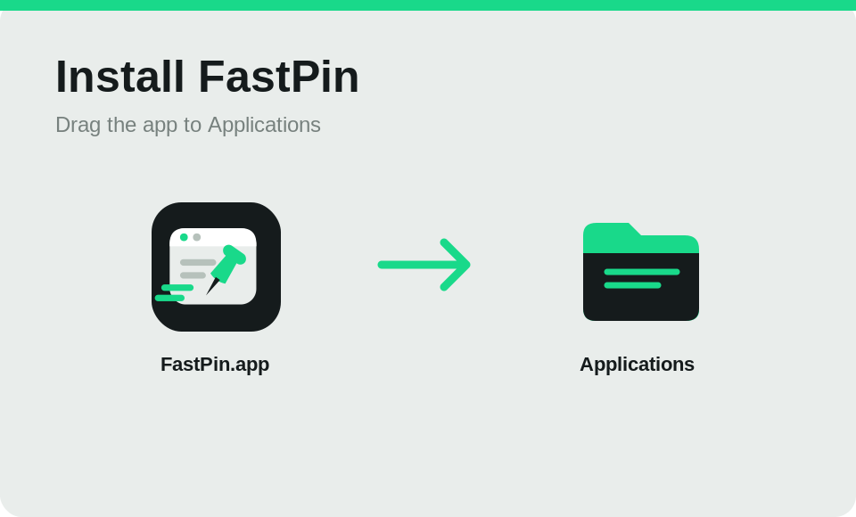
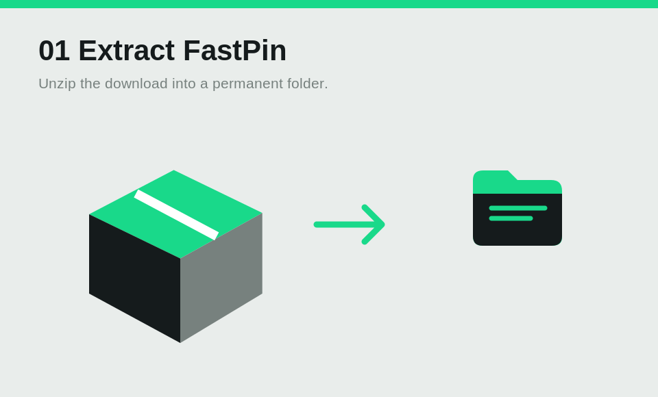
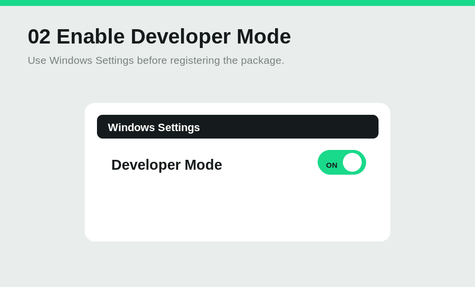

# FastPin — quick start

Capture a piece of your screen, add a note, and keep it on your desktop.

## Install



**macOS preview:** macOS 14 or newer, Apple Silicon. Open the DMG and drag FastPin into Applications. This preview is not notarized. If macOS blocks its first launch, follow [Apple's app-opening instructions](https://support.apple.com/en-us/102445). Grant Screen Recording when prompted. Element detection and mouse shortcuts also use Accessibility permission. Follow the first-run guide; reopen it with Getting started.





**Windows developer preview:** Windows 10 version 2004 or newer / Windows 11, x64. Extract the Windows ZIP into a permanent folder. Enable Developer Mode in Windows Settings, then open PowerShell in the extracted folder and run:

```powershell
Add-AppxPackage -Register "$PWD\AppxManifest.xml"
```


Launch FastPin from Start. Keep the extracted folder in place while installed. OCR uses installed Windows OCR language packs; add your language in Windows Settings if needed. See [Microsoft's loose-file registration guide](https://learn.microsoft.com/en-us/windows/apps/develop/testing/loose-file-registration). To uninstall, use Windows Settings → Apps, then remove the extracted folder.

## Capture, annotate, pin

1. Choose Capture screenshot from the menu bar/tray, or press Ctrl+Shift+2. Drag to select a region. Tab switches between Window and Element detection; click a detected target to select it.
2. Use the floating toolbar: P for pen, A for arrow, R for rectangle, T for text. With T selected, click the image and type. Enter finishes text, Shift+Enter adds a line, and Escape cancels text. To edit a completed text annotation, select T and click its text again. Enter applies the edit; Escape keeps the previous text. Undo/redo uses your platform's usual shortcuts. Re-editing works within the current capture or live pin; PNG exports and restored images contain flattened text.
3. Press Space or Enter to pin the selected image. Its tools start hidden. Drag the pin to move it; use the wheel to zoom. Hover over the image and press Space to show its tools; press Space again to hide them. Escape closes it.

Choose Restore last image, or press Ctrl+Shift+4, to bring back the most recent capture/pin with its annotations. Paste as pin / Ctrl+Shift+3 pins an image from the clipboard.

## Copy text from your screen

Press **Ctrl+Shift+5**, or choose **Copy text from screen** in the panel or menu bar/tray. Drag around the text and release the mouse: FastPin recognizes it and copies it to your clipboard. Paste into any app. You can also click a detected window, or press Tab to switch to Element detection.

Press Escape to cancel. If no text is found, your clipboard is kept. Change the OCR shortcut in Preferences, including mouse side-button combinations.

## Dictionary and translation

Press **Ctrl+Shift+1**, drag around the text and release the mouse to translate immediately. Choose **Dictionary / translate** in the panel or menu bar/tray for the same flow. Like every default, it uses Ctrl+Shift and a number key you can reach with the left hand, so it never takes over Ctrl+D (end of input in terminals, forward delete in macOS text fields, bookmarks in browsers). Translation leaves your clipboard unchanged; use the card's copy button to copy the result.

The card appears immediately with **Recognizing text…**, then shows the dictionary result or **Translating…** in place. You can close it while recognition is running; it stays closed when the result arrives.

After selecting a region in the normal capture mode, you can also press **Shift+O**, or choose **Dictionary / translate** on the toolbar. The same action works on a pinned image. OCR runs locally and copies the recognized source text.

Words and known short phrases use the bundled CC-CEDICT dictionary: English to traditional Chinese, or traditional/simplified Chinese to English. A small translation card is pinned next to the pointer without taking keyboard focus. Drag its header to move it, click the speaker to hear the source text with the system voice, or click × to remove the card. Its copy button copies the translation. A missing word stays offline until you choose **Online**.

Sentences use the free MyMemory translation API and show the result in the same card. The selected text is sent to MyMemory; the target is traditional Chinese for English, or English for Chinese. No API key, account, billing setup or LLM API is used. The provider allows 500 UTF-8 bytes per selection and 5,000 characters per day for anonymous use. Network or quota errors stay in the card. See the provider's [API specification](https://mymemory.translated.net/doc/spec.php) and [usage limits](https://mymemory.translated.net/doc/usagelimits.php).

## More useful controls

| Task | Control |
| --- | --- |
| Copy selected image | Cmd+C on macOS / Ctrl+C on Windows |
| Save selected image | Cmd+S on macOS / Ctrl+S on Windows |
| Copy recognized text | O, or OCR on the toolbar |
| Look up words / translate sentences | Shift+O, or Dictionary / translate on the toolbar |
| Copy a pixel's color | C while capturing |
| Switch HEX / RGB | Shift while capturing |
| Sample the next physical pixel | Arrow keys |
| Reset a pin's zoom | 0 |
| Restore mouse input for click-through pins | Menu bar/tray → Restore mouse input for all pins |

Change capture, paste, restore, OCR, and translation bindings in Preferences. Click a shortcut field, press a key combination or side-button gesture, release it, then choose Apply shortcuts. Clear a field to disable that shortcut.

Close or hide the control panel to leave FastPin in the menu bar/tray. Quit from its menu when finished.

[Download FastPin](https://github.com/TempestShaw/FastPin/releases) · [Report an issue](https://github.com/TempestShaw/FastPin/issues)
