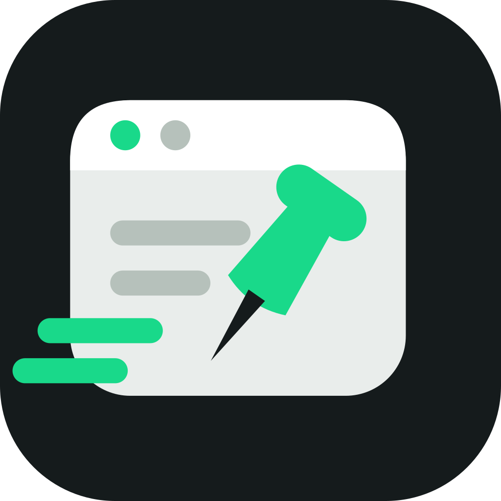
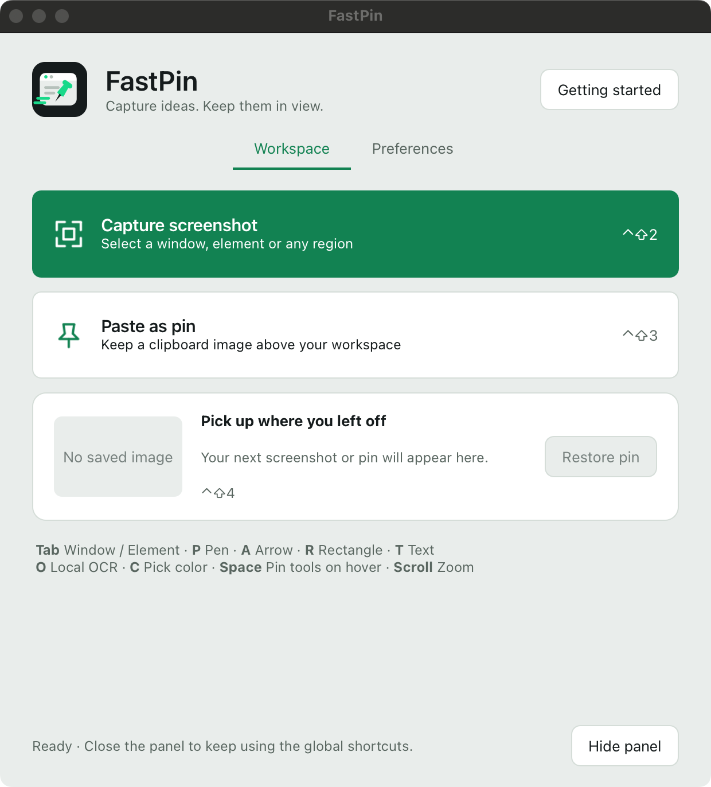

<p align="center">
  
</p>

<h1 align="center">FastPin</h1>

<p align="center">Capture what matters. Keep it in view.</p>

<p align="center">
  <a href="https://fastpin.happysage32.chatgpt.site/">Website</a> ·
  <a href="https://github.com/TempestShaw/FastPin/releases">Download</a> ·
  <a href="GETTING_STARTED.md">Quick Start</a> ·
  <a href="#your-first-capture">Your First Capture</a> ·
  <a href="https://github.com/TempestShaw/FastPin/issues">Feedback</a>
</p>

<p align="center">
  <a href="https://github.com/TempestShaw/FastPin/releases"></a>
  
  <a href="LICENSE.md"></a>
</p>

FastPin turns a screenshot into a reference you can keep above your work. Select a window, a UI element, or any region; add an arrow or a note; then pin it to your desktop. Move and zoom your pins, copy text with OCR, or pick an exact pixel's color.

## A look at FastPin

<p align="center">
  <a href="https://fastpin.happysage32.chatgpt.site/">
    
  </a>
</p>

Capture something new, pin an image from your clipboard, or pick up where you left off. The [website](https://fastpin.happysage32.chatgpt.site/) includes an interactive annotation preview and a first-launch guide.

## Your first capture

1. Press **Ctrl+Shift+2**, or choose **Capture screenshot** from the menu bar or tray. Drag to select a region. Press **Tab** to switch between **Window** and **Element** detection.
2. Mark what matters: **P** for pen, **A** for arrow, **R** for rectangle, or **T** for text. With Text selected, click the image and type directly on it. **Enter** finishes text; **Shift+Enter** adds a line.
3. Press **Space** or **Enter** to pin the image. Drag to move it and scroll to zoom. Its toolbar starts hidden: hover over the pin and press **Space** to show or hide the tools.

Already have an image copied? Press **Ctrl+Shift+3** to pin it. Closed a pin you still need? **Ctrl+Shift+4** restores your last image with its annotations and zoom.

These are the defaults. Change them in **Preferences** to use your own keys or mouse side buttons.

## Why use FastPin?

- **Keep a reference beside your work.** Leave multiple images above other windows, move them where you need them, and zoom in on a detail.
- **Explain the important part.** Use four focused annotation tools: pen, arrow, rectangle, and inline text, with undo and redo.
- **Skip retyping.** Select a region and press **O** to copy recognized text, or use OCR from a pin's toolbar.
- **Sample a precise color.** Use the capture magnifier and arrow keys to position the cursor one pixel at a time. Press **C** to copy the color; **Shift** switches HEX and RGB.
- **Make the controls yours.** Bind capture, paste, restore, and quick OCR to a key combination, a function key, or a mouse side-button gesture.

To grab text quickly, press **Ctrl+Shift+5**, drag around it, and release. The recognized text is copied straight to your clipboard. You can also choose **Copy text from screen** in the panel or menu.

## Install

| Platform | Download | Requirements |
| --- | --- | --- |
| macOS | [Apple Silicon DMG](https://github.com/TempestShaw/FastPin/releases/download/v0.1.0-preview.5/FastPin-0.1.0-preview.5-macOS-arm64.dmg) | macOS 14 or newer |
| Windows | [x64 ZIP](https://github.com/TempestShaw/FastPin/releases/download/v0.1.0-preview.5/FastPin-0.1.0-preview.5-Windows-x64.zip) | Windows 10 version 2004 or newer / Windows 11 |

**macOS:** open the DMG and drag FastPin into Applications. Allow Screen Recording when prompted; Element detection and mouse shortcuts also use Accessibility permission. This preview is not notarized. If the first launch is blocked, follow [Apple's app-opening instructions](https://support.apple.com/en-us/102445).

**Windows:** extract the ZIP into a permanent folder and enable Developer Mode. Open PowerShell in the extracted folder and register the app:

```powershell
Add-AppxPackage -Register "$PWD\AppxManifest.xml"
```

Launch FastPin from Start and keep the extracted folder in place. OCR uses your installed Windows OCR language packs.

The [illustrated Quick Start](GETTING_STARTED.md) walks through installation, permissions, and the first capture on each platform.

## Useful controls

| Task | Control |
| --- | --- |
| Capture a screenshot | Ctrl+Shift+2 |
| Copy text from screen | Ctrl+Shift+5 |
| Pin an image from the clipboard | Ctrl+Shift+3 |
| Restore the last image | Ctrl+Shift+4 |
| Switch Window / Element detection | Tab while capturing |
| Show or hide a pin's tools | Space while hovering over the pin |
| Move / zoom a pin | Drag / scroll |
| Copy recognized text | O, or OCR on the toolbar |
| Copy a pixel's color | C while capturing |
| Switch HEX / RGB | Shift while capturing |
| Save an image | Cmd+S on macOS / Ctrl+S on Windows |

To change a global shortcut, open **Preferences**, click its field, press your keys or side buttons, then choose **Apply shortcuts**. Hold both side buttons for a combination and release them to finish. Clear a field to disable that shortcut. On Mac, **Ctrl** means the Control key (**⌃**); Command is **⌘**.

## Explore and contribute

- [Quick Start](GETTING_STARTED.md): installation, capture, pinning, OCR, and color picking.
- [Releases](https://github.com/TempestShaw/FastPin/releases): downloads and what's new.
- [Report a problem or suggest a feature](https://github.com/TempestShaw/FastPin/issues): include your OS, FastPin version, and steps to reproduce.
- [Build from source](docs/BUILD.md): FastPin is a standalone C++17 application using Qt Widgets.

## Credits and license

FastPin grew out of the native C++ implementation developed in [ScreenPinKit](https://github.com/InterwovenCode/ScreenPinKit). Original attribution and the MIT license are preserved in [LICENSE.md](LICENSE.md) and [NOTICE.md](NOTICE.md). Qt and bundled library notices are included in [`licenses/`](licenses/).
